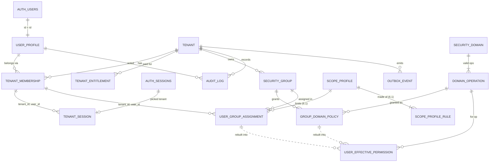

# Goal 1 data model

**Story:** 1.0 (docs only). **Status:** in review, 19 Oct 2026. Owner answered D1 to D9 on 19 Oct 2026.

**Purpose:** the tables, columns, keys and joins that stories 1.1 to 1.6 build, so each migration is a copy job, not a design job. Read with `CLAUDE.md` §6 to §8 and `security-model.md`.

The model below follows the **owner decisions**. Each place a decision shaped it is marked **[D1]** to **[D9]**. The decisions are in [section 7](#7-owner-decisions).

Open items applied: OQ-16 (sales-led, tenants and first admin created by a provisioning script), OQ-17 (**changed by D3**: the user picks the tenant at login, plus a header switcher), OQ-23 (short token, version check), OQ-30 (hand-seeded `tenant_entitlement`, `tenant.status`, write-check helper), OQ-24 (only the four scope dimensions). OQ-22 and OQ-25 do not change the schema.

---

## 1. Conventions used in every table

| Rule | What it means here |
|---|---|
| Primary key | `id uuid primary key default gen_random_uuid()` |
| Foreign keys | `<entity>_id`. Foreign keys to another tenant table are **composite**: `(tenant_id, x_id) references x (tenant_id, id)`. So a row can never point at another tenant's row. Every tenant table has `unique (tenant_id, id)` for this |
| Standard columns ("std") | `created_at timestamptz not null default now()`, `updated_at timestamptz not null default now()` (set by trigger), `created_by uuid null references user_profile(id)`, `updated_by uuid null references user_profile(id)`, `deleted_at timestamptz null`. `created_by` is null for system and provisioning writes |
| Soft delete | `deleted_at`. Unique constraints are partial: `where deleted_at is null` |
| Time | `timestamptz`, stored UTC |
| Lifecycles | Fixed system lifecycles use `text` with a `check` (for example `tenant.status`). No Postgres enums, so adding a value is a one-line migration |
| Codes | Catalog and group codes are lower `snake_case` text, `check (code ~ '^[a-z][a-z0-9_]*$')` |
| `auth` schema | Only `user_profile` references `auth.users`, and only `tenant_session` references `auth.sessions`. Everything else references `user_profile`. Keeps a later move off Supabase Auth to two tables |
| Schemas | Business tables in `public`. Derived and internal tables (`user_effective_permission`, `outbox_event`) in `private`, which the API does not expose |
| RLS | On for every table, both schemas. A table with no policy means no access |

---

## 2. Tables

### Tenancy at a glance

| Table | Story | Schema | Tenancy | Std columns |
|---|---|---|---|---|
| `tenant` | 1.1 | public | Is the tenant (no `tenant_id`) | Yes |
| `user_profile` | 1.1 | public | Global, one per login (no `tenant_id`) | Yes |
| `tenant_membership` | 1.1 | public | `tenant_id` | Yes |
| `tenant_entitlement` | 1.1 | public | `tenant_id` | Yes |
| `tenant_session` | 1.1 | private | `tenant_id`, one row per login session | `selected_at` only |
| `security_domain` | 1.2 | public | Platform catalog, read-only to tenants | `created_at`, `updated_at` only |
| `domain_operation` | 1.2 | public | Platform catalog, read-only to tenants | `created_at`, `updated_at` only |
| `security_group` | 1.2 | public | `tenant_id` | Yes |
| `group_domain_policy` | 1.2 | public | `tenant_id` | Yes |
| `user_group_assignment` | 1.2 | public | `tenant_id` | Yes |
| `user_effective_permission` | 1.3 | private | `tenant_id`, derived | No (rebuilt, never edited) |
| `audit_log` | 1.5 | public | `tenant_id`, append-only | No (append-only) |
| `outbox_event` | 1.5 | private | `tenant_id`, system only | No |
| `scope_profile` | 6.1 | public | `tenant_id` | Yes |
| `scope_profile_rule` | 6.1 | public | `tenant_id` | Yes |

`tenant` and `user_profile` are the two tables without `tenant_id` that are not catalogs. The CI check "table with `tenant_id` must have RLS and policies" does not cover them, so their cross-tenant tests are written by hand in 1.4.

### 2.1 `tenant` (1.1)

One row per customer company. Created by the provisioning script (OQ-16), never by signup.

| Column | Type | Notes |
|---|---|---|
| `id` | uuid PK | |
| `name` | text not null | Display name |
| `slug` | text not null | `unique`, `check (slug ~ '^[a-z0-9-]+$')`. For support and logs. No subdomains in Phase 1 |
| `status` | text not null default `'active'` | `check in ('active','read_only','suspended')`. OQ-30. Read by `tenant_can_write()` |
| `currency_code` | char(3) not null | ISO 4217. Default currency for money fields. **[D2]** |
| `locale` | text not null default `'en-IN'` | BCP 47. Drives number format. **[D2]** |
| `time_zone` | text not null | IANA name, for example `Asia/Kolkata`. **[D2]** |
| `date_format` | text not null | For example `dd-MM-yyyy`. **[D2]** |
| std | | |

- No India defaults in the schema except the `locale` example. Provisioning passes all four values.
- Fiscal year start (settled in section A of the open-items tracker) is added in 2.5 as `fiscal_year_start_month smallint`. Adding a column is cheap.
- **RLS:** select where the user has an active membership in that tenant (so the header switcher can list names). No write grants for users. Settings change only through `update_tenant_settings()` (2.5, data-model-goal2.md §5, S1).

### 2.2 `user_profile` (1.1)

One row per login. Global, because one person can belong to several tenants.

| Column | Type | Notes |
|---|---|---|
| `id` | uuid PK | `references auth.users(id) on delete restrict`. Same value as the auth user id |
| `display_name` | text not null | |
| `email` | text not null | Copy of the auth email, for display and audit. Kept in sync by the provisioning script (no Auth trigger needed in Phase 1) |
| std | | |

- No last-used tenant here. The chosen tenant is per login session, in `tenant_session`. **[D3]**
- **RLS:** a user reads and updates their own row (`id = (select auth.uid())`). A user also reads profiles of people who share their **current** tenant (to show names in lists and audit). No insert or delete for users.

### 2.3 `tenant_membership` (1.1)

Joins a user to a tenant. The token's `tenant_id` must match an active membership.

| Column | Type | Notes |
|---|---|---|
| `id` | uuid PK | |
| `tenant_id` | uuid not null | FK `tenant(id)` |
| `user_id` | uuid not null | FK `user_profile(id)` |
| `status` | text not null default `'active'` | `check in ('active','disabled')` |
| `permission_version` | integer not null default 1 | Goes in the token. **[D4]** |
| std | | |

- `unique (tenant_id, user_id)`, **not** partial. `user_group_assignment` uses it as a composite FK target **[D5]**, and a FK needs a full unique constraint. So a person has one membership row per tenant for life: removing them sets `status = 'disabled'` (or `deleted_at`), and adding them back reuses the row.
- `unique (tenant_id, id)` for composite FKs
- Index `(user_id) where status = 'active' and deleted_at is null`: the JWT hook path
- **RLS:** a user reads their own memberships in any tenant (for the switcher). In the current tenant, `has_permission('users_security','view')` reads all, `manage` writes (Goal 6 UI). Provisioning uses the service role.

### 2.4 `tenant_entitlement` (1.1)

What the tenant has paid for. Hand-seeded in Phase 1 (OQ-30). Not enforced except the AI add-on check (Goal 10).

| Column | Type | Notes |
|---|---|---|
| `id` | uuid PK | |
| `tenant_id` | uuid not null | FK `tenant(id)` |
| `feature_code` | text not null | For example `ai_addon`, `asset_limit`. Data, not an enum |
| `limit_value` | integer null | For counted features such as asset count. Null means on with no limit |
| `valid_from` | timestamptz not null default now() | |
| `valid_to` | timestamptz null | Null means open-ended |
| std | | |

- `unique (tenant_id, feature_code, valid_from) where deleted_at is null`
- `check (valid_to is null or valid_to > valid_from)`
- **RLS:** read in the current tenant (the UI hides "Ask Assetly" without `ai_addon`). No user writes. Service role only.

### 2.4a `tenant_session` (1.1), `private` schema

The tenant the user picked for one login session. **[D3]** A new sign-in is a new Supabase session with no row, so the user is asked again. Two devices can be in two different tenants.

| Column | Type | Notes |
|---|---|---|
| `session_id` | uuid PK | `references auth.sessions(id) on delete cascade`. Sign-out and session expiry remove the row |
| `user_id` | uuid not null | |
| `tenant_id` | uuid not null | FK `(tenant_id, user_id)` to `tenant_membership(tenant_id, user_id)`. So it can only name a tenant the user belongs to |
| `selected_at` | timestamptz not null default now() | |

- No std columns and no soft delete: the row lives and dies with the auth session. It is not business data.
- Written only by `select_tenant()` (section 4). Read only by the JWT hook.
- **RLS:** on, no policies.

### 2.5 `security_domain` (1.2), platform catalog

A securable slice of the product. Seeded by migration with `on conflict (code) do nothing` so re-runs add no duplicates. Catalog contents per OQ-25 (draft in 1.2).

| Column | Type | Notes |
|---|---|---|
| `id` | uuid PK | |
| `code` | text not null unique | For example `asset_core`, `asset_financials`, `users_security`, `audit_log`, `tenant_settings`. Never renamed once shipped |
| `entity` | text not null | For example `asset`, `vendor`, `platform` |
| `kind` | text not null | `check in ('entity','field','action','platform')` |
| `description` | text not null | English source text. The UI shows a translated label keyed by `code` |
| `is_system` | boolean not null default true | All Phase 1 domains are system domains |
| `created_at`, `updated_at` | timestamptz | |

- **RLS:** select with `users_security.view` only (owner decision, 19 Oct 2026; policy in 1.3). No writes except migrations.

### 2.6 `domain_operation` (1.2), platform catalog

The valid operations of each domain. The policy grid is drawn from these rows (open-items change #6).

| Column | Type | Notes |
|---|---|---|
| `id` | uuid PK | |
| `security_domain_id` | uuid not null | FK `security_domain(id)` |
| `code` | text not null | For example `view`, `create`, `update`, `delete`, `execute`, `manage`, `run`, `commit`, `undo` |
| `sort_order` | smallint not null default 0 | Grid column order |
| `created_at`, `updated_at` | timestamptz | |

- `unique (security_domain_id, code)`. Seeded with `on conflict do nothing`.
- **RLS:** select with `users_security.view` only (owner decision, 19 Oct 2026; policy in 1.3). No writes except migrations.

### 2.7 `security_group` (1.2)

A role. Starter groups are seeded per tenant in 1.6.

| Column | Type | Notes |
|---|---|---|
| `id` | uuid PK | |
| `tenant_id` | uuid not null | FK `tenant(id)` |
| `code` | text not null | For example `tenant_admin`, `auditor` |
| `name` | text not null | Tenant-editable display name (data, not translated) |
| `group_type` | text not null default `'role'` | `check in ('role','system')`. `system` groups (owner, billing) cannot be edited by the tenant. `integration` is added in Goal 9 |
| `template_code` | text null | Which starter or industry template it came from. Text now, a FK only if 7.1 needs one |
| `description` | text null | |
| std | | |

- `unique (tenant_id, code) where deleted_at is null`
- `unique (tenant_id, id)`
- **RLS:** read with `users_security.view`. Write with `users_security.manage` and `tenant_can_write()`, and never on `group_type = 'system'`.

### 2.7a Starter groups (1.6)

Five `role` groups every new tenant gets. Provisioning (run as `postgres`, OQ-16) calls `private.seed_starter_groups(tenant_id)`. Each group is an ordinary tenant row with `template_code = 'starter.<code>'`, so the tenant can edit it. Re-running skips a template the tenant already has (even if edited or soft-deleted), so it adds no duplicates and never undoes a tenant's change.

Open items: **OQ-25** lean used (draft catalog and starter groups in M1). **OQ-22** lean used (single approver): Tenant Admin alone holds `users_security.manage`; there is no separate security approver group.

Grant matrix. The migration `1_6_starter_groups` and the test `1_6_starter_groups.test.sql` hold the same grid, and CI fails if `has_permission` disagrees with it for any catalog operation. `rls_sample` (the 1.4 template) is in no group. A dash means no grant.

| Domain | Tenant Admin | Plant Manager | Planner | Technician | Auditor |
|---|---|---|---|---|---|
| `asset_core` | view, create, update, delete | view, create, update, delete | view, update | view | view |
| `asset_financials` | view, update | view | – | – | view |
| `asset_lifecycle` | execute | execute | – | – | – |
| `vendor_core` | view, create, update, delete | view, create, update | view | view | view |
| `vendor_tax_ids` | view, update | view | – | – | view |
| `coverage_contract` | view, create, update, delete | view, create, update | view, create, update | view | view |
| `coverage_values` | view, update | view | – | – | view |
| `obligation` | view, create, update, complete | view, create, update, complete | view, create, update, complete | view, complete | view |
| `service_record` | view, create, update, complete | view, create, update, complete | view, create, update, complete | view, create, update, complete | view |
| `location_hierarchy` | view, manage | view, manage | view | view | view |
| `category_config` | view, manage | view | view | view | view |
| `excel_import` | run, review, commit | run, review, commit | run, review | – | – |
| `import_undo` | undo | undo | – | – | – |
| `users_security` | view, manage | – | – | – | view |
| `api_keys` | view, manage | – | – | – | view |
| `audit_log` | view | view | – | – | view |
| `tenant_settings` | view, manage | view | – | – | view |
| `ai_usage` | view, manage | view | – | – | view |
| `insights_query` | ask | ask | ask | – | – |
| `insights_widget` | save, share | save, share | save | – | – |

Tenant Admin holds every operation in the catalog. Auditor holds every `view` and nothing else.

### 2.8 `group_domain_policy` (1.2)

Grants one operation of one domain to one group. **One row per operation. [D6]**

| Column | Type | Notes |
|---|---|---|
| `id` | uuid PK | |
| `tenant_id` | uuid not null | |
| `security_group_id` | uuid not null | FK `(tenant_id, security_group_id)` to `security_group(tenant_id, id)` |
| `domain_operation_id` | uuid not null | FK `domain_operation(id)` (catalog, so single-column) |
| std | | |

- `unique (security_group_id, domain_operation_id) where deleted_at is null`
- Index `(tenant_id, security_group_id)` for the rebuild
- No `status` or `version` columns. Drafts arrive with change sets in 6.4. **[D9]**
- **RLS:** as `security_group`. Every insert, update and soft delete writes a `security` audit row (1.5) and bumps `permission_version` for the group's members **[D4]**.

### 2.9 `user_group_assignment` (1.2)

Gives a group to a member, for a time window. **Points to the user plus tenant. [D5]**

| Column | Type | Notes |
|---|---|---|
| `id` | uuid PK | |
| `tenant_id` | uuid not null | |
| `user_id` | uuid not null | FK `user_profile(id)`, and FK `(tenant_id, user_id)` to `tenant_membership(tenant_id, user_id)`. The second FK proves the user is a member of this tenant, with no trigger |
| `security_group_id` | uuid not null | FK `(tenant_id, security_group_id)` to `security_group(tenant_id, id)` |
| `effective_from` | timestamptz not null default now() | |
| `effective_to` | timestamptz null | Null means open-ended |
| `scope_profile_id` | uuid null | **Added in 6.1**, FK `(tenant_id, scope_profile_id)` to `scope_profile`. Null means tenant-wide. **[D7]** |
| std | | |

- `check (effective_to is null or effective_to > effective_from)`
- No unique key: the same group may be assigned twice with different scopes or windows. Grants are additive, so overlaps are harmless.
- Index `(tenant_id, user_id)` and `(tenant_id, security_group_id)` for the rebuild.
- A disabled membership keeps its assignment rows (history), but the rebuild skips them, so they grant nothing.
- **RLS:** as `security_group`. Changes are `security` audit rows and bump the member's `permission_version`.

### 2.10 `scope_profile` and `scope_profile_rule` (6.1, not Goal 1)

Defined here so the Goal 1 keys leave room for them. Built in 6.1, after locations (2.3), categories (2.1) and vendors (4.1) exist. **[D7]**

`scope_profile`

| Column | Type | Notes |
|---|---|---|
| `id` | uuid PK | |
| `tenant_id` | uuid not null | |
| `name` | text not null | For example "Pune plant" |
| std | | |

- `unique (tenant_id, name) where deleted_at is null`, `unique (tenant_id, id)`

`scope_profile_rule`: one row per allowed value. Rules on the same dimension combine with OR. Different dimensions combine with AND. A dimension with no rule is unrestricted.

| Column | Type | Notes |
|---|---|---|
| `id` | uuid PK | |
| `tenant_id` | uuid not null | |
| `scope_profile_id` | uuid not null | FK `(tenant_id, scope_profile_id)` |
| `dimension` | text not null | `check in ('location','category','vendor','criticality')` |
| `location_id` | uuid null | FK `(tenant_id, location_id)` to `location`. Includes descendants through the closure table (2.3) |
| `category_id` | uuid null | FK to `category`. Includes child categories |
| `vendor_id` | uuid null | FK to `vendor` |
| `criticality` | text null | `check in ('A','B','C')` |
| std | | |

- `check` that exactly the column matching `dimension` is set.
- Index `(tenant_id, scope_profile_id, dimension)`.

### 2.11 `user_effective_permission` (1.3), derived, `private` schema

The flat table every RLS check reads. Never edited by hand. Rebuilt per member by `private.rebuild_effective_permission(tenant_id, user_id)`.

| Column | Type | Notes |
|---|---|---|
| `tenant_id` | uuid not null | |
| `user_id` | uuid not null | From the assignment |
| `domain_operation_id` | uuid not null | FK `domain_operation(id)` |
| `effective_from` | timestamptz not null | Copied from the assignment |
| `effective_to` | timestamptz null | Copied from the assignment |
| `scope_profile_id` | uuid null | **Added in 6.1.** Null means tenant-wide. **[D7]** |
| `rebuilt_at` | timestamptz not null default now() | |

- No `id`, no std columns, no soft delete: rows are deleted and reinserted on rebuild. This is the one table that breaks the std-column rule, on purpose.
- Primary key: none. Index `(tenant_id, user_id, domain_operation_id)`: the `has_permission()` path.
- Rows exist only for **active** memberships, groups and policies that are not soft-deleted. One row per distinct (operation, effective window): a grant that several groups give with the same window is one row (1.7, G2). Policy changes rebuild each affected member once per statement (1.7, G1).
- Effective dates are checked at read time, so an assignment starting next Monday works without a job.
- **Rebuild triggers** (same transaction as the change): insert, update or soft delete on `group_domain_policy` (rebuild every member of that group), `user_group_assignment` (that member), `tenant_membership` status (that member), `security_group` soft delete (every member).
- **RLS:** on, no policies. Read only through `security definer` helpers.

### 2.12 `audit_log` (1.5)

One append-only log for data and security changes. **[D8]**

| Column | Type | Notes |
|---|---|---|
| `id` | uuid PK | |
| `tenant_id` | uuid not null | |
| `occurred_at` | timestamptz not null default now() | |
| `category` | text not null | `check in ('data','security')` **[D8]** |
| `actor_type` | text not null | `check in ('user','system')` |
| `actor_user_id` | uuid null | FK `user_profile(id)`. Null for system jobs |
| `action` | text not null | `insert`, `update`, `soft_delete`, or an action code such as `asset.transfer` |
| `table_name` | text not null | |
| `record_id` | uuid not null | |
| `old_data` | jsonb null | Changed columns only, before |
| `new_data` | jsonb null | Changed columns only, after |
| `reason` | text null | For actions that need one (retire, postpone) |
| `transaction_id` | bigint not null default `txid_current()` | Groups rows written by one action |

- Written by one generic trigger function `private.audit_row()` attached per table, plus explicit inserts from action functions. Same transaction as the change.
- Index `(tenant_id, table_name, record_id, occurred_at desc)` for the Audit tab, `(tenant_id, occurred_at desc)` for the log screen.
- **RLS:** select with `audit_log.view` (`category = 'data'`) or `users_security.view` (`category = 'security'`). **No insert, update or delete policies.** `update` and `delete` revoked from all roles. A `before update or delete` trigger raises, so even the table owner cannot edit history by mistake.

### 2.13 `outbox_event` (1.5), `private` schema

Domain events, written in the same transaction as the change. The poller (Goal 9) reads them with the service role.

| Column | Type | Notes |
|---|---|---|
| `id` | uuid PK | |
| `tenant_id` | uuid not null | |
| `occurred_at` | timestamptz not null default now() | |
| `event_type` | text not null | For example `asset.status_changed`, `coverage.expiring` |
| `aggregate_type` | text not null | For example `asset` |
| `aggregate_id` | uuid not null | |
| `payload` | jsonb not null | |
| `published_at` | timestamptz null | Set by the poller |
| `attempts` | integer not null default 0 | |
| `last_error` | text null | |

- Index `(occurred_at) where published_at is null`: the poller path.
- **RLS:** on, no policies. Users never read it. Written by `security definer` functions.

---

## 3. Joins



Dotted lines are derived: `user_effective_permission` is the join of membership, assignment, group and policy, flattened.

The rebuild, in one statement:

```sql
-- membership m -> assignment a -> group g -> policy p -> operation
select m.tenant_id, m.user_id, p.domain_operation_id, a.effective_from, a.effective_to
from tenant_membership m
join user_group_assignment a on a.tenant_id = m.tenant_id and a.user_id = m.user_id and a.deleted_at is null
join security_group g        on g.tenant_id = a.tenant_id and g.id = a.security_group_id and g.deleted_at is null
join group_domain_policy p   on p.tenant_id = g.tenant_id and p.security_group_id = g.id and p.deleted_at is null
where m.tenant_id = $1 and m.user_id = $2 and m.status = 'active' and m.deleted_at is null;
```

---

## 4. JWT hook (1.1)

A Supabase custom access token hook, `private.custom_access_token_hook(event jsonb)`, written in SQL and kept in a migration. It runs on sign-in and on every token refresh.

**Reads:** `tenant_session` for the session in `event->'claims'->>'session_id'`, then that tenant's `tenant_membership` row, which must be active and not deleted, and `tenant.status <> 'suspended'`. **[D3]** It never picks a default tenant.

**Puts in the token** (two claims, nothing else):

| Claim | Value |
|---|---|
| `tenant_id` | The chosen membership's `tenant_id` |
| `permission_version` | That membership's `permission_version` |

No `tenant_session` row yet, or its membership is no longer active: no claims are added. Every tenant policy then denies.

**Login flow [D3]:**

1. Email and password sign-in. The first token has no `tenant_id`.
2. The app lists the user's active memberships (their own `tenant_membership` rows joined to `tenant` names; both readable without a tenant claim).
3. Several tenants: the app shows a "Choose company" step. One tenant: the app picks it without asking. None: a "no access" page.
4. The app calls the public function `select_tenant(p_tenant_id uuid)`. It checks an active membership, then upserts `tenant_session (session_id = auth.jwt()->>'session_id', user_id, tenant_id)`.
5. The app calls `supabase.auth.refreshSession()`. The hook runs again and puts that `tenant_id` in the token.

The header switcher calls the same `select_tenant()` and refresh. No custom token store, and no default tenant.

**What the version is for:** policies read `user_effective_permission` live, so a revoked grant stops working at once, whatever the token says. The token's `tenant_id` is trusted only because the rebuild deletes a removed member's rows. The `permission_version` lets the UI notice that its cached menus are stale: on page load and before sensitive screens, the client compares the claim with its membership row and refreshes the session on mismatch (OQ-23 lean). **[D4]**

`tenant_id` is read in SQL as `private.current_tenant_id()`:

```sql
select nullif(auth.jwt() ->> 'tenant_id', '')::uuid
```

---

## 5. `has_permission()` and `tenant_can_write()` (1.3)

Both in `private`, `stable`, `security definer`, `set search_path = ''`. Story 1.3 grants `usage` on `private` and `execute` on these to `authenticated`.

```sql
create function private.has_permission(p_domain text, p_operation text)
returns boolean language sql stable security definer set search_path = '' as $$
  select exists (
    select 1
    from private.user_effective_permission uep
    join public.domain_operation o on o.id = uep.domain_operation_id
    join public.security_domain d  on d.id = o.security_domain_id
    where uep.tenant_id = private.current_tenant_id()
      and uep.user_id   = (select auth.uid())
      and d.code = p_domain and o.code = p_operation
      and uep.effective_from <= now()
      and (uep.effective_to is null or uep.effective_to > now())
  );
$$;

create function private.tenant_can_write()
returns boolean language sql stable security definer set search_path = '' as $$
  select exists (select 1 from public.tenant t
                 where t.id = private.current_tenant_id() and t.status = 'active');
$$;
```

Policies call them inside `(select ...)` so Postgres runs each once per statement, not once per row:

```sql
using (tenant_id = (select private.current_tenant_id())
       and (select private.has_permission('asset_core', 'view')))
```

`has_permission()` ignores scope. From 6.1, a second helper checks a row's location, category, vendor and criticality against the user's `scope_profile_id` rows (null scope passes). **[D7]**

---

## 6. Not in Goal 1

- **Scope profiles**: tables defined in 2.10, built in 6.1.
- **`policy_change_set`** and draft or active policy status: story 6.4. **[D9]**
- **`sod_rule`**: later phase.
- **Integration users and API keys**: Goal 9. Knowledge base §12 names no Goal 1 hook for them, so nothing is reserved. They will likely be a membership plus a `group_type = 'integration'` group.
- **Audit of reads of restricted domains** (security-model §9): needs the secure views from 6.2.
- **Audit partitioning and retention**: not before the 1.7 spike shows a need.

---

## 7. Owner decisions

Each item was **DECIDE**. The owner answered all nine on 19 Oct 2026, and the model above follows the answers. "Cost to reverse" assumes the change happens after the story that builds it has shipped to staging.

### D1. `tenant`, `user_profile`, `tenant_membership`, `tenant_entitlement` are missing from the security model (open-items change #4). DECIDED

| Option | |
|---|---|
| A | Accept the four tables as in 2.1 to 2.4. `security-model.md` §7 gets four purpose rows and a link to this file, which holds the columns |
| B | Same tables, but copy the full column lists into `security-model.md` |

**Lean: A.** One home for columns, so the two files cannot drift.
**Owner: accept the four tables as in 2.1 to 2.4.** Docs home taken as A.
**Cost to reverse:** docs only, none. The table shapes themselves are covered by D2 to D5.

### D2. Tenant settings: columns on `tenant`, or a separate table. DECIDED

| Option | |
|---|---|
| A | Columns on `tenant` (`currency_code`, `locale`, `time_zone`, `date_format`) |
| B | A 1:1 `tenant_setting` table |
| C | A key-value `tenant_setting (tenant_id, key, value jsonb)` table |

**Lean: A.** Four fixed values read on every page. No join, and real types and checks. Mandatory-field rules go with field definitions (2.5), and the AI flag is a `tenant_entitlement` row.
**Owner: A,** with currency, locale, time zone and date format.
**Cost to reverse:** low before Goal 3 (move four columns, fix one read). Medium after, when money and date display read them.

### D3. Where the last-used tenant lives (OQ-17). DECIDED

| Option | |
|---|---|
| A | `tenant_membership.last_selected_at`. Hook picks the newest |
| B | `user_profile.last_tenant_id` (FK to `tenant`) |
| C | Browser storage only. Hook always picks the oldest membership |
| D | No default. The user picks the tenant at every login. The pick is stored per login session |

**Lean was A.**
**Owner: D.** "While login ask user to select tenant first instead of defaulting it." Built as `tenant_session` (2.4a), `select_tenant()` and the login flow in section 4. No last-used column anywhere. A user with only one tenant skips the picker. This changes the OQ-17 lean.
**Cost to reverse:** low. One small table, one function and the hook's read.

### D4. Permission version: per user, per membership or per tenant, and what bumps it (OQ-23). DECIDED

| Option | |
|---|---|
| A | Per membership. Bumped by that member's assignment changes, policy or group changes on any group they hold, and their membership status change |
| B | Per tenant. Any security change in the tenant bumps it. Simple, but every user refreshes |
| C | Per user (on `user_profile`). Crosses tenants, so a change in tenant A refreshes tokens for tenant B |

**Lean: A.** The token is per active tenant, so the version should be too. The bumps happen in the same triggers that call the rebuild.
**Owner: A.**
**Cost to reverse:** low. One column and the bump triggers. Access itself does not depend on it (section 4).

### D5. Does `user_group_assignment` point to `tenant_membership` or to the user? DECIDED

| Option | |
|---|---|
| A | `tenant_membership_id`, with a composite FK on `tenant_id` |
| B | `user_id` (to `user_profile`) plus `tenant_id` |
| C | `user_id` to `auth.users` directly |

**Lean was A.** C ties security data to Supabase Auth (portability, CLAUDE.md §3).
**Owner: B.** Not linked to D3: tenant choice at login works the same with A or B. B is made as safe as A by a second composite FK `(tenant_id, user_id)` to `tenant_membership(tenant_id, user_id)`, so an assignment can only name a member of that tenant, with no trigger. The price: that membership unique key cannot be partial (2.3), so a person keeps one membership row per tenant and is re-enabled, not re-added.
**Cost to reverse:** medium. Repoint one FK, rewrite the rebuild join, migrate rows.

### D6. `group_domain_policy` operations: one row per operation, or an array. DECIDED

| Option | |
|---|---|
| A | One row per (group, operation), FK to `domain_operation` |
| B | One row per (group, domain) with `operations text[]` |

**Lean: A.** The FK proves the operation is valid for the domain without a trigger, the rebuild is a plain join, and the 6.4 change-set diff is row inserts and deletes.
**Owner: A.**
**Cost to reverse:** low before 6.3 (the grid UI). The rebuild is the only reader.

### D7. Shape of the scope profile and rules, and how `user_effective_permission` stores scope. DECIDED

Rules:

| Option | |
|---|---|
| A | One rule row per value, a typed FK column per dimension (`location_id`, `category_id`, `vendor_id`, `criticality`) |
| B | One rule row per value, generic `(dimension, value_id uuid)` with no FK |
| C | JSONB on `scope_profile`, for example `{"location": [...], "category": [...]}` |

Scope in `user_effective_permission`:

| Option | |
|---|---|
| X | Store `scope_profile_id`. The row check joins the rules, and the location closure table for descendants |
| Y | Explode scope into rows, one per allowed location (descendants included) |

**Lean: A and X.** A keeps real FKs, so deactivation and the merge function (B12) repoint rule values like any other reference. X keeps the derived table small and does not need a rebuild when the location tree changes. The 1.7 spike measures X on 1M assets.
**Owner: A and X.**
**Cost to reverse:** rules medium (a data migration of rule rows). `user_effective_permission` low: it is derived, so changing it is a rebuild.

### D8. One `audit_log`, or a separate `security_audit_log`. DECIDED

| Option | |
|---|---|
| A | One `audit_log` with `category in ('data','security')` |
| B | Separate `security_audit_log` (as `security-model.md` §7 names it) |

**Lean: A.** One trigger function, one screen, one retention rule. The category column gives security entries their own read permission.
**Owner: A.**
**Cost to reverse:** medium. Copying rows out is easy, but every writer and the screen change.

### D9. Policy status and version (draft or active) now, or wait for 6.4. DECIDED

| Option | |
|---|---|
| A | Wait. 6.4 adds `policy_change_set` and its draft rows. Live policy rows stay plain |
| B | Add `status` (default `'active'`) and `version` to `group_domain_policy` now, unused until 6.4 |

**Lean: A.** `stories-tracker.md` puts staged activation in 6.4. Unused columns now would need every Goal 1 query to filter on them.
**Owner: A.**
**Cost to reverse:** low. Adding columns with defaults is one migration, and drafts may not need columns on the live table at all.

---

## 8. Docs to update now the owner has decided

| Doc | Change |
|---|---|
| `security-model.md` §7 | Add `tenant`, `user_profile`, `tenant_membership`, `tenant_entitlement` rows and a link here (D1). `security_audit_log` becomes `audit_log` with category (D8). Mark `group_domain_policy` status and version as 6.4 (D9) |
| `security-model.md` §8.6 | Say what bumps the version and that access does not depend on it (D4) |
| `open-items-tracker.md` | OQ-17: decided, user picks the tenant at login, no default (D3). OQ-23: version per membership (D4). Mark follow-up change #4 done (D1) |
| `docs/assetly-screens.html` | Add a "Choose company" step after sign-in for users with several tenants (D3) |
| `technical-architecture.md` line 95 | Point to section 4 of this file for the hook |
| `asset-management-platform-knowledge-base.md` §5 | "Tenant Settings" are columns on Tenant, the AI entitlement is in Tenant Entitlement (D2) |
| `CLAUDE.md` §8 | Add the composite same-tenant FK rule from section 1 |
| `CLAUDE.md` §3 | Region says Mumbai. Staging is in Tokyo by owner decision (not part of this story) |
